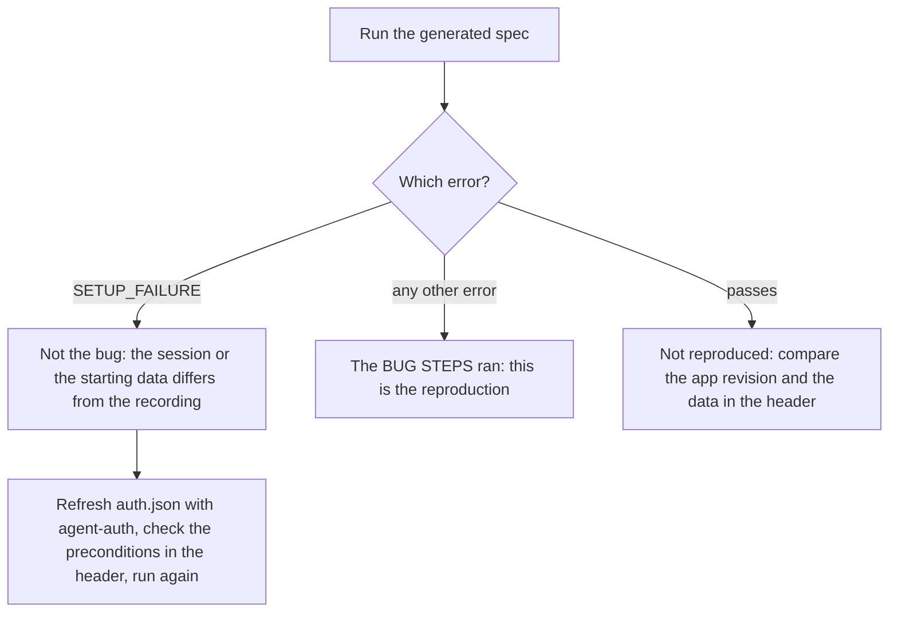
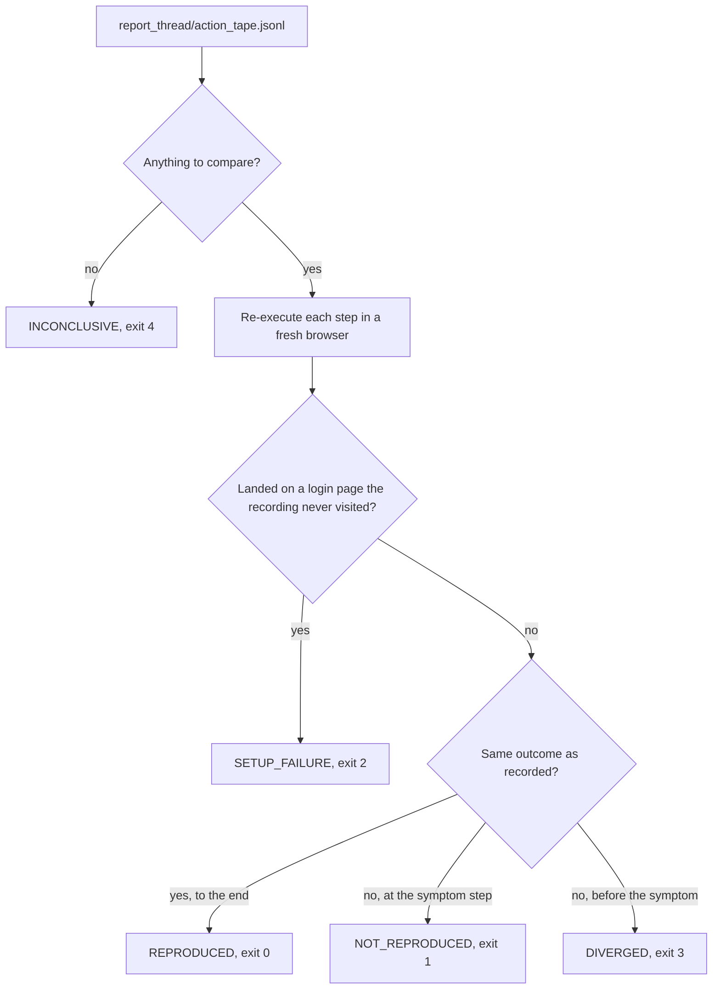
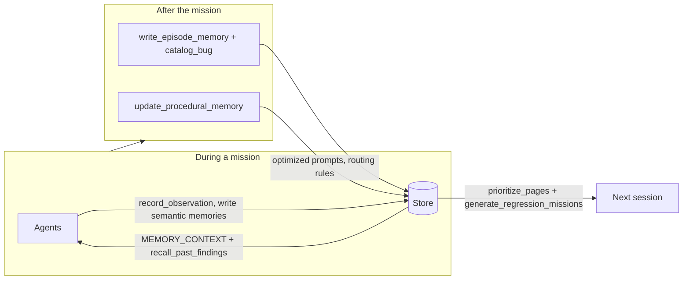
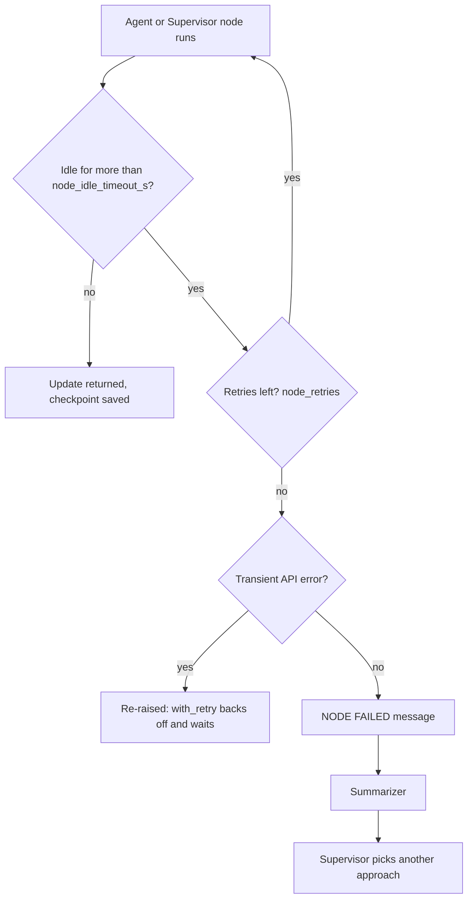
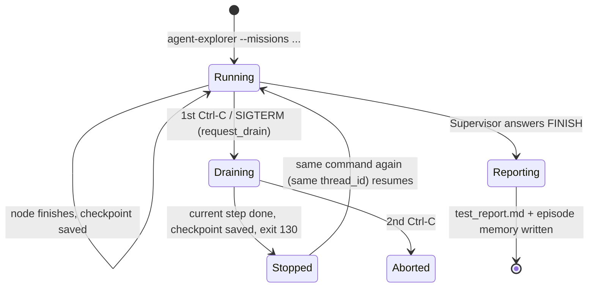

# Complete Architecture Guide: Agentic Test Explorer

## Table of Contents

1. [Project Overview](#1-project-overview)
2. [Theoretical Foundations: LangChain and LangGraph](#2-theoretical-foundations-langchain-and-langgraph)
3. [The State Graph (StateGraph)](#3-the-state-graph-stategraph)
4. [Nodes, Edges, and Conditional Routing](#4-nodes-edges-and-conditional-routing)
5. [The Supervisor-Worker Pattern (Swarm)](#5-the-supervisor-worker-pattern-swarm)
6. [The Shared State: AgentState](#6-the-shared-state-agentstate)
7. [Tools and the @tool Decorator](#7-tools-and-the-tool-decorator)
8. [The Browser Engine: Record-and-Translate](#8-the-browser-engine-record-and-translate)
9. [Language Models (LLM): Multiple Providers](#9-language-models-llm-multiple-providers)
10. [Persistence: Checkpoints and Store](#10-persistence-checkpoints-and-store)
11. [The 4-Level Memory System](#11-the-4-level-memory-system)
12. [External Integrations: MCP and Skills](#12-external-integrations-mcp-and-skills)
13. [Missions: YAML Format and Routing](#13-missions-yaml-format-and-routing)
14. [Test Generation from Pull Requests](#14-test-generation-from-pull-requests)
15. [Complete Execution Flow](#15-complete-execution-flow)
16. [Key Architectural Patterns](#16-key-architectural-patterns)
17. [Glossary](#17-glossary)
18. [References and Official Documentation](#18-references-and-official-documentation)

---

## 1. Project Overview

### What Is Agentic Test Explorer?

It is an **autonomous exploratory QA** framework that uses artificial intelligence agents to test web applications automatically. Instead of writing manual tests, you define "missions" in natural language and the AI agents navigate the application looking for bugs, just as a human tester with different personalities would.

### An Analogy to Understand It

Imagine you hire a QA testing team:

- **A novice user** who has never seen the application
- **A power user** who knows every shortcut
- **A mischievous "hacker"** who tries to break everything

Each one has their own personality and testing strategy. A **supervisor** assigns them tasks and decides who tests what. This project replicates exactly that team, but with AI agents.

### High-Level Architecture

```
                    +------------------+
                    |   YAML Missions  |
                    | (natural language)|
                    +--------+---------+
                             |
                    +--------v---------+
                    |      main.py     |
                    |  (CLI / Dispatch)|
                    +--------+---------+
                             |
              +--------------+--------------+
              |                             |
    +---------v---------+       +-----------v-----------+
    |   Standard Graph  |       |    Advanced Graph     |
    |   (3 personas)    |       |   (5 personas + exp.) |
    +---------+---------+       +-----------+-----------+
              |                             |
    +---------v-----------------------------v---------+
    |               SUPERVISOR NODE                    |
    |  (LLM decides which agent acts next)             |
    +--+-------+--------+--------+--------+--------+--+
       |       |        |        |        |        |
       v       v        v        v        v        v
    [Agent1] [Agent2] [Agent3] [Agent4] [Agent5] [Explorer]
       |       |        |        |        |        |
       +-------+--------+--------+--------+--------+
                         |
              +----------v-----------+
              |   Browser Engine     |
              |  (Playwright)        |
              |  JSON intent -> exec |
              +----------+-----------+
                         |
              +----------v-----------+
              |   Action Tape        |
              |  (immutable JSONL)   |
              +----------+-----------+
                         |
              +----------v-----------+
              |  Generated .spec.ts  |
              |  (reproducible)      |
              +----------------------+
```

### Core Technologies

| Technology | Role in the Project | Documentation |
|---|---|---|
| **LangGraph** | Agent graph orchestration | [docs.langchain.com/oss/python/langgraph](https://docs.langchain.com/oss/python/langgraph/graph-api) |
| **LangChain** | LLM and tool abstraction | [docs.langchain.com/oss/python/langchain](https://docs.langchain.com/oss/python/langchain/tools) |
| **Playwright** | Browser automation | [playwright.dev/python](https://playwright.dev/python/) |
| **Claude / Gemini** | Language models (the brain) | [docs.anthropic.com](https://docs.anthropic.com) / [ai.google.dev](https://ai.google.dev) |
| **MCP** | Context protocol for external tools | [github.com/langchain-ai/langchain-mcp-adapters](https://github.com/langchain-ai/langchain-mcp-adapters) |

---

## 2. Theoretical Foundations: LangChain and LangGraph

### What Is LangChain?

**LangChain** is a Python framework that simplifies building applications on top of language models (LLMs). It provides abstractions for:

- **Chat Models:** Unified interfaces for different LLM providers (Claude, GPT, Gemini, etc.)
- **Tools:** Functions the LLM can "decide to call" during its reasoning
- **Chains:** Step sequences (prompt -> LLM -> parser -> action)
- **Agents:** Systems where the LLM dynamically chooses which tools to use

> **Official documentation:** [docs.langchain.com/oss/python/langchain](https://docs.langchain.com/oss/python/langchain/tools)

### What Is LangGraph?

**LangGraph** is a library built *on top of* LangChain that allows defining workflows as **state graphs**. While LangChain provides the building blocks (LLMs, tools, prompts), LangGraph connects them into complex flows with cycles, branches, and persistence.

**Analogy:** If LangChain provides the bricks, LangGraph is the building's blueprint.

**Key LangGraph concepts:**

| Concept | Description | Analogy |
|---|---|---|
| **StateGraph** | The workflow container | A board game |
| **State** | The data shared between nodes | The game's tokens and markers |
| **Node** | A function that transforms the state | A turn in the game |
| **Edge** | A connection between nodes | The rules for advancing |
| **Conditional Edge** | A connection that depends on the state | "If you roll a 6, go to..." |
| **Checkpointer** | State persistence across executions | Saving the game |
| **Store** | Long-term memory across threads | The player's memory |

> **Official documentation:** [docs.langchain.com/oss/python/langgraph/graph-api](https://docs.langchain.com/oss/python/langgraph/graph-api)

### The Relationship Between the Two

```
+----------------------------------------------------------+
|                      LangGraph                            |
|  +----------------------------------------------------+  |
|  |  StateGraph + Nodes + Edges + Checkpointer + Store |  |
|  |                                                    |  |
|  |  Uses internally:                                  |  |
|  |  +----------------------------------------------+  |  |
|  |  |               LangChain                      |  |  |
|  |  |  ChatAnthropic | ChatGoogleGenerativeAI      |  |  |
|  |  |  @tool decorator | StructuredTool             |  |  |
|  |  |  BaseMessage | HumanMessage | AIMessage       |  |  |
|  |  +----------------------------------------------+  |  |
|  +----------------------------------------------------+  |
+----------------------------------------------------------+
```

---

## 3. The State Graph (StateGraph)

### Theory: What Is a StateGraph?

A `StateGraph` is the centerpiece of LangGraph. It is a **directed graph** where:

- Each **node** is an asynchronous function that receives the current state and returns updates
- Each **edge** connects nodes and defines the execution order
- The **state** is a typed dictionary (`TypedDict`) shared among all nodes

The execution model is inspired by **Pregel** (Google's system for large-scale graph processing): nodes execute in "super-steps" and the state is updated between each step.

### How to Create a StateGraph

```python
from langgraph.graph import StateGraph, END

# 1. Define the state schema
class MyState(TypedDict):
    messages: list
    next_node: str

# 2. Create the graph
workflow = StateGraph(MyState)

# 3. Add nodes
workflow.add_node("node_a", function_a)
workflow.add_node("node_b", function_b)

# 4. Add edges
workflow.add_edge("node_a", "node_b")
workflow.add_edge("node_b", END)

# 5. Define the entry point
workflow.set_entry_point("node_a")

# 6. Compile
app = workflow.compile()
```

### In This Project: `compile_swarm()` (`graph_base.py`)

This project does not use a simple graph, but rather a **cyclic graph** where the Supervisor can redirect execution to different agents multiple times. Here is how it is built:

```python
# File: src/agentic_explorer/orchestration/graph_base.py

def compile_swarm(workflow, agent_registry: dict, checkpointer, store=None):
    """Wire agents -> Summarizer -> Supervisor -> conditional routing -> END"""
    from langgraph.graph import END

    agent_names = tuple(agent_registry.keys())

    # 1. Add the Summarizer node (message compression)
    workflow.add_node("Summarizer", make_summarizer_node())

    # 2. Each agent -> Summarizer (after acting, messages are summarized)
    for agent_name in agent_names:
        workflow.add_edge(agent_name, "Summarizer")

    # 3. Summarizer -> Supervisor (the supervisor decides the next step)
    workflow.add_edge("Summarizer", "Supervisor")

    # 4. Supervisor -> agent OR end (conditional routing)
    route_map = {name: name for name in agent_names}
    route_map["FINISH"] = END

    workflow.add_conditional_edges(
        "Supervisor",                          # source node
        lambda state: state["next_agent"],     # decision function
        route_map,                             # destination map
    )

    # 5. The Supervisor is the entry point
    workflow.set_entry_point("Supervisor")

    # 6. Compile with persistence
    return workflow.compile(checkpointer=checkpointer, store=store)
```

### Diagram of the Resulting Graph

```
                    ENTRY
                      |
                      v
               +------+------+
               |  SUPERVISOR  |  <--- Decides which agent acts
               +------+------+
                      |
         +-----conditional_edges------+
         |            |               |
         v            v               v
   +-----------+ +-----------+  +-----------+
   | Agent #1  | | Agent #2  |  | Agent #N  |     "FINISH" -> END
   +-----------+ +-----------+  +-----------+
         |            |               |
         +------------+---------------+
                      |
                      v
              +--------------+
              | SUMMARIZER   |  <--- Compresses old messages
              +--------------+
                      |
                      v
               (back to SUPERVISOR)
```

This is a **cyclic graph**: the Supervisor redirects to an agent, the agent acts, the messages are summarized, and the Supervisor decides again. The cycle continues until the Supervisor decides `"FINISH"`.

> **Official documentation on StateGraph:** [reference.langchain.com/python/langgraph/graph/state/StateGraph](https://reference.langchain.com/python/langgraph/graph/state/StateGraph)

---

## 4. Nodes, Edges, and Conditional Routing

### Theory: Nodes

A **node** in LangGraph is simply a function (synchronous or asynchronous) that:

1. **Receives** the current state as a parameter
2. **Executes** logic (calling an LLM, querying a database, running a tool...)
3. **Returns** a dictionary with the state keys it wants to update

```python
# Basic node example
async def my_node(state: AgentState) -> dict:
    # Read from the state
    messages = state["messages"]

    # Do something
    result = await process(messages)

    # Return ONLY the keys that change
    return {"messages": [result]}
```

**Important rule:** A node does NOT need to return all state keys. It only returns those it modifies. LangGraph handles merging the updates with the existing state.

### Theory: Edges

LangGraph supports two types of edges:

#### 1. Static Edges (`add_edge`)

These always go from A to B, with no conditions:

```python
workflow.add_edge("new_user_agent", "Summarizer")
# After new_user_agent finishes, it ALWAYS goes to Summarizer
```

In this project, all agents have a static edge to the Summarizer:

```python
# graph_base.py, compile_swarm()
for agent_name in agent_names:
    workflow.add_edge(agent_name, "Summarizer")
```

#### 2. Conditional Edges (`add_conditional_edges`)

The decision of where to go depends on the state:

```python
workflow.add_conditional_edges(
    "Supervisor",                          # Source node
    lambda state: state["next_agent"],     # Function that reads the state
    {                                      # Destination map
        "new_user_agent": "new_user_agent",
        "power_user_agent": "power_user_agent",
        "adversarial_user_agent": "adversarial_user_agent",
        "FINISH": END,                     # END is a special LangGraph constant
    },
)
```

**How it works:** After the `Supervisor` node finishes, LangGraph calls the lambda function. If `state["next_agent"]` is `"power_user_agent"`, execution goes to the `power_user_agent` node. If it is `"FINISH"`, the graph terminates.

### In This Project: The Three Types of Nodes

The project defines three node factories in `graph_base.py`:

| Factory | File | Purpose |
|---|---|---|
| `make_agent_node()` | graph_base.py | Wraps a compiled agent as a LangGraph node |
| `make_supervisor_node()` | graph_base.py | Creates the supervisor node that routes to the next agent |
| `make_summarizer_node()` | graph_base.py | Compresses messages to prevent context overflow (keeps the mission prompt and the 20 most recent; one deterministic summary in between, placed right after the mission prompt) |

Per-node timeouts, retries and failure handling are attached when the nodes are registered (`orchestration/resilience.py`); see section 15.

> **Official documentation on conditional edges:** [reference.langchain.com/python/langgraph/graph/state/StateGraph/add_conditional_edges](https://reference.langchain.com/python/langgraph/graph/state/StateGraph/add_conditional_edges)

---

## 5. The Supervisor-Worker Pattern (Swarm)

### Theory: Multi-Agent Patterns in LangGraph

LangGraph offers two main patterns for multi-agent systems:

#### Pattern 1: Supervisor

A central LLM (the "supervisor") receives tasks and delegates to specialized agents. It is like a team lead who decides who works on what.

```
     User
        |
        v
   [Supervisor]  <---- LLM that decides
    /    |    \
   v     v     v
[Ag1] [Ag2] [Ag3]
```

> **Official documentation:** [github.com/langchain-ai/langgraph-supervisor-py](https://github.com/langchain-ai/langgraph-supervisor-py)

#### Pattern 2: Swarm

There is no central supervisor. Agents pass control directly to each other using `Command(goto=...)`. It is like a self-organizing team.

> **Official documentation:** [github.com/langchain-ai/langgraph-swarm-py](https://github.com/langchain-ai/langgraph-swarm-py)

#### This Project: Custom Supervisor

This project implements a **custom variant of the Supervisor pattern**. It does not use the `langgraph-supervisor` library directly, but builds its own supervisor with additional logic:

- **Step control:** Resets when a limit is exceeded
- **Memory context:** Injects knowledge from past sessions
- **Exploration context:** Reports which areas have already been visited

### The Supervisor Node: `make_supervisor_node()` (`graph_base.py`)

Here is how the supervisor works step by step:

```python
def make_supervisor_node(llm, agent_names, app_url, max_steps, ...):

    # 1. Define the structured response schema
    routing_schema = {
        "title": "SupervisorRouting",
        "type": "object",
        "properties": {
            "next": {
                "type": "string",
                "enum": [*agent_names, "FINISH"]  # Can only choose these values
            },
        },
        "required": ["next"],
    }

    # 2. Create an LLM that ONLY responds with valid JSON
    routing_llm = llm.with_structured_output(
        schema=routing_schema,
        method="function_calling"
    )

    async def supervisor_node(state: AgentState, *, store=None) -> dict:
        # 3. Increment the step counter
        current_step = state.get("step_count", 0) + 1

        # 4. If the limit is exceeded, reset and force fresh exploration
        if current_step > max_steps:
            reset_msg = HumanMessage(content=(
                f"[STEP LIMIT] Navigate back to {app_url} and pick "
                "a COMPLETELY DIFFERENT area."
            ))
            current_step = 1  # Reset

        # 5. Query long-term memory (known pages, previous bugs)
        if store:
            memory_context = await format_memory_context(store, url_hash)

        # 6. Build the routing "brief" (compact context)
        routing_context = _build_routing_context(state, extra_messages, memory_context)

        # 7. Ask the LLM to decide
        decision = await routing_llm.ainvoke([
            SystemMessage(content=supervisor_prompt),
            HumanMessage(content=f"...{routing_context}...\nWhich agent should act next?")
        ])

        # 8. Return the decision
        return {"next_agent": decision["next"], "step_count": current_step}

    return supervisor_node
```

**Key point:** The `with_structured_output()` method forces the LLM to respond **only** with a JSON object containing the `"next"` key with one of the allowed values. This eliminates ambiguity: the LLM cannot invent agents that do not exist.

### The Two Graph Types

The project defines two graphs ("tiers") depending on mission complexity. Both are built by the same function, `build_graph(..., tier=...)` in `orchestration/graph.py`, from the single persona registry in `orchestration/personas.py` (`PERSONAS`). Each mission names its tier with a `graph:` field (see section 13).

#### Standard tier: 3 Personas

| Agent | Role | Focus |
|---|---|---|
| `new_user_agent` | Novice User | Onboarding, discovery, default states |
| `power_user_agent` | Power User | Shortcuts, bulk operations, advanced filters |
| `adversarial_user_agent` | Chaos Monkey | Invalid inputs, SQL injection, rapid clicking |

#### Advanced tier: 5 agents (4 personas + the autonomous Explorer)

| Agent | Role | Focus |
|---|---|---|
| `accessibility_user_agent` | Accessibility | WCAG, keyboard navigation, screen readers |
| `data_heavy_user_agent` | Data Heavy | Large files, many records, performance |
| `impatient_user_agent` | Impatient User | Canceling mid-action, refreshing during submissions, race conditions |
| `returning_user_agent` | Returning User | Expired sessions, cached pages, expired tokens |
| `explorer_agent` | Autonomous Explorer | Total chaos: filters, dropdowns, toggles, boundary values |

### How an Agent Is Built

Each agent is created with LangChain's `create_agent()`, which receives an LLM, tools, and a system prompt. The prompt comes from the persona's entry in the registry:

```python
# orchestration/graph.py (build_graph)
for persona in personas_for_tier(tier):
    system_prompt = persona.system_prompt(            # Agent personality
        app_name=app.name, app_url=app.url,
        app_description=app.description, supplement=supplement,  # learned memory
    )
    agent_registry[persona.name] = create_agent(
        llm,
        tools=tools,                                  # Shared tool bundle
        system_prompt=SystemMessage(content=system_prompt),
    )
```

The system prompt combines:
- **Role:** "You are the New User / First-Timer Persona"
- **App context:** "The application under test is 'Uyuni', accessible at ..."
- **Focus:** "Test onboarding, discoverability, default states..."
- **Browser rules:** BROWSER_AGENT_RULES (selector policy, allowed actions, etc.)

---

## 6. The Shared State: AgentState

### Theory: TypedDict and Reducers

In LangGraph, the shared state is defined as a Python `TypedDict`. Each field can have a **reducer** (a reducing function) that determines how updates are combined.

**Without a reducer:** The update simply **overwrites** the previous value.

**With a reducer:** The reducer function receives `(old_value, new_value)` and returns the combined value.

```python
from typing import Annotated
import operator

class MyState(TypedDict):
    # With reducer operator.add: lists are CONCATENATED
    messages: Annotated[list, operator.add]

    # Without a reducer: the value is OVERWRITTEN
    name: str
```

### In This Project: AgentState (graph_base.py)

```python
class AgentState(TypedDict):
    # Chat messages. Reducer: add_messages -> they accumulate, a repeated id replaces
    # the message, and a RemoveMessage deletes it
    messages: Annotated[Sequence[BaseMessage], add_messages]

    # Name of the next agent. No reducer -> overwritten
    next_agent: str

    # Browser action tape. Custom reducer -> max 50 entries
    action_tape: Annotated[List[Dict], _bounded_tape_reducer]

    # Step counter. Lambda reducer -> always the latest value
    step_count: Annotated[int, lambda _old, new: new]

    # Bugs found. Reducer: operator.add -> they accumulate
    bugs_found: Annotated[List[str], operator.add]

    # Visited URLs. Reducer: operator.add -> they accumulate
    explored_paths: Annotated[List[str], operator.add]
```

### Field-by-Field Explanation

#### `messages` -- Conversation History

```python
messages: Annotated[Sequence[BaseMessage], add_messages]
```

- **Type:** List of `BaseMessage` (LangChain's base class for messages)
- **Reducer:** `add_messages` -- each node can add messages and they are appended to the history; a message whose `id` already exists replaces it, and a `RemoveMessage(id=...)` deletes it. That is what lets the Summarizer actually shrink the history: with a plain `operator.add` the `RemoveMessage` entries were appended instead of deleting anything, and the history grew without bound.
- **Agent nodes return only what they produced.** A compiled agent streams back its input plus its new messages; returning all of it re-added the whole history on every turn and re-extracted every earlier bug.
- **Message subtypes used:**
  - `HumanMessage`: The user's mission or supervisor directives
  - `AIMessage`: LLM responses/reasoning
  - `ToolMessage`: Results of executed tools
  - `SystemMessage`: System instructions (the Summarizer's compressed summary is a `HumanMessage`)
  - `RemoveMessage`: Special message for deleting messages from the history (used by the Summarizer)

#### `next_agent` -- Routing

```python
next_agent: str
```

- **No reducer** -- the Supervisor overwrites it on each cycle
- Contains the name of the next agent (`"new_user_agent"`, `"FINISH"`, etc.)
- Read by the conditional edge to decide where to go

#### `action_tape` -- Browser Action Log

```python
action_tape: Annotated[List[Dict], _bounded_tape_reducer]
```

- **Custom reducer** (`_bounded_tape_reducer`):

```python
def _bounded_tape_reducer(old, new):
    combined = (old or []) + (new or [])
    return combined[-50:]  # Only the 50 most recent
```

- **Why limit to 50?** The complete Action Tape is persisted to disk as JSONL. In the state, we keep only the most recent entries to prevent LLM context overflow. This is a **sliding window pattern**.

#### `step_count` -- Infinite Loop Prevention

```python
step_count: Annotated[int, lambda _old, new: new]
```

- **Lambda reducer:** Always returns the new value (overwrites)
- The Supervisor increments it on each cycle
- When it exceeds `max_steps`, the agent is reset to the application's starting page

#### `bugs_found` and `explored_paths` -- Tracking

```python
bugs_found: Annotated[List[str], operator.add]
explored_paths: Annotated[List[str], operator.add]
```

- Both use `operator.add` to accumulate data from all iterations. Each node returns only the **delta** (what it found this turn) and the reducer concatenates
- They feed the Supervisor's context to avoid redundancy and guide exploration

> **Official documentation on state and reducers:** [docs.langchain.com/oss/python/langgraph/graph-api](https://docs.langchain.com/oss/python/langgraph/graph-api)

---

## 7. Tools and the @tool Decorator

### Theory: What Is a Tool in LangChain?

A **Tool** is a function that an LLM can "decide to call" during its reasoning. The flow is:

1. You describe the tool to the LLM (name + description + parameters)
2. The LLM reasons and decides: "I need to call tool X with these arguments"
3. The framework executes the tool and returns the result to the LLM
4. The LLM incorporates the result into its reasoning

This cycle is known as **ReAct** (Reasoning + Acting).

### Ways to Define Tools

#### 1. The `@tool` Decorator (the most common)

```python
from langchain_core.tools import tool

@tool
async def my_tool(parameter: str) -> str:
    """Description that the LLM will read to decide whether to use this tool.

    Args:
        parameter: Explanation of the parameter.
    """
    result = await do_something(parameter)
    return result
```

**Key points:**
- The **docstring** is crucial: the LLM reads it to decide when to use the tool
- The **type hints** automatically define the input schema
- The **function name** becomes the tool name

#### 2. `StructuredTool.from_function()` (more control)

```python
from langchain_core.tools import StructuredTool

my_tool = StructuredTool.from_function(
    func=my_function,
    name="custom_name",
    description="Custom description",
    args_schema=MyPydanticModel,
)
```

> **Official documentation on tools:** [docs.langchain.com/oss/python/langchain/tools](https://docs.langchain.com/oss/python/langchain/tools)

### Tools in This Project

The project defines several specialized tools, all as factory functions that capture environment resources (such as the Playwright `page`):

#### Browser Tools (engine.py)

| Tool | File | Description |
|---|---|---|
| `execute_browser_command` | engine.py | Executes ONE JSON action in the browser |
| `get_dom_snapshot` | engine.py | Reads the current DOM (read-only) |
| `generate_reproduction_spec` | engine.py | Generates a .spec.ts from the Action Tape |

#### Capture Tools (custom_tools.py)

| Tool | Description |
|---|---|
| `capture_bug_screenshot` | Captures a screenshot when a bug is detected |
| `analyze_visual_state` | Sends a screenshot to a vision-capable LLM for validation |

#### Memory Tools (memory.py + Langmem)

| Tool | Origin | Description |
|---|---|---|
| `recall_past_findings` | memory.py (custom) | Semantic (or keyword) search over bugs, sessions, and quirks |
| `record_observation` | Langmem `create_manage_memory_tool` | Proactively records observations for future sessions |

### Detailed Example: `execute_browser_command`

This is the most important tool in the project. Here is how it is built:

```python
# engine.py
def get_browser_command_tool(page: Page):
    """Factory: captures the reference to the Playwright page."""

    @tool
    async def execute_browser_command(command_json: str, config: RunnableConfig) -> str:
        """Execute ONE browser action described as strict JSON...

        Argument `command_json` MUST be a JSON object string, for example:
            {"action": "navigate", "url": "https://example.com/app"}
            {"action": "click", "selector": "[data-test-subj='submitButton']"}
        """
        # 1. Get the thread_id from config (for the Action Tape)
        thread_id = config.get("configurable", {}).get("thread_id", "default")

        # 2. Parse the JSON from the agent
        parsed = json.loads(command_json)
        action = parsed["action"]
        params = {k: v for k, v in parsed.items() if k != "action"}

        # 3. Validate the selector (rejects XPath and brittle selectors)
        selector_error = _validate_selector(params.get("selector", ""))
        if selector_error:
            return f"STATUS: ERROR\nERROR: {selector_error}"

        # 4. Execute the action with Playwright
        result = await _dispatch(page, action, params)

        # 5. Capture a DOM snapshot after the action
        snap = await extract_dom_snapshot(page)

        # 6. Record in the Action Tape (immutable)
        _append_tape(thread_id, result.to_tape_entry())

        # 7. Return the formatted result to the agent
        return f"STATUS: OK\nRESULT: {result}\nDOM_SNAPSHOT:\n{formatted_snapshot}"

    return execute_browser_command
```

**Factory pattern:** The function `get_browser_command_tool(page)` is a **factory** that returns the tool with the Playwright `page` "captured" in the closure. This allows the tool to access the page without it being an agent parameter.

**RunnableConfig:** The `config: RunnableConfig` parameter is automatically injected by LangGraph. It contains metadata such as the `thread_id` of the current mission. This allows the tool to write to the correct Action Tape.

---

## 8. The Browser Engine: Record-and-Translate

### Theory: Brain / Hands Separation

The project implements an architectural pattern called **Record-and-Translate**, which separates two responsibilities:

```
+--------------------+    JSON intent    +-------------------+
|    BRAIN (AI)      | ----------------> |   HANDS (Engine)  |
| LangGraph Agents   |                  |   Playwright       |
| Decide WHAT to do  |                  |   Executes HOW     |
+--------------------+                  +-------------------+
                                                |
                                         Records everything in
                                                |
                                                v
                                        +-------------------+
                                        |   Action Tape     |
                                        | (immutable JSONL)  |
                                        +-------------------+
                                                |
                                         Translated to
                                                v
                                        +-------------------+
                                        |   .spec.ts        |
                                        |   (Playwright)    |
                                        +-------------------+
```

**Why this separation?**

1. **Determinism:** Browser actions are deterministic and reproducible
2. **Debuggability:** The Action Tape is an immutable log of everything that was done
3. **Reproducibility:** The tape is translated into an executable Playwright script
4. **Security:** Agents do not have direct access to Playwright -- they can only emit validated JSON intents

### Supported Actions

The engine only accepts a fixed set of actions (engine.py):

```python
ALLOWED_ACTIONS = {
    "navigate",       # {"action": "navigate", "url": "https://..."}
    "click",          # {"action": "click", "selector": "[data-test-subj='btn']"}
    "fill",           # {"action": "fill", "selector": "input#name", "value": "Oscar"}
    "press",          # {"action": "press", "selector": "input", "key": "Enter"}
    "select_option",  # {"action": "select_option", "selector": "select", "value": "opt1"}
    "hover",          # {"action": "hover", "selector": ".menu-trigger"}
    "wait_for",       # {"action": "wait_for", "selector": ".content", "state": "visible"}
    "scroll",         # {"action": "scroll", "selector": ".panel"}  or {"y": 400}
    "extract_text",   # {"action": "extract_text", "selector": "h1"}
    "snapshot",       # {"action": "snapshot"}  -- read-only DOM
    "check_page_health",  # Detects error banners and spinners
}
```

### Resilient Selector Policy

One of the most important patterns in the project is **selector validation** (engine.py):

```python
# REJECTED selectors (brittle, depend on DOM position):
_BRITTLE_SELECTOR_PATTERNS = re.compile(r"""
    (^/)                     # XPath: /html/body/div[1]
    | (/{2})                 # Descendant XPath: //div[@class='x']
    | (:nth-child\s*\()      # Positional CSS: li:nth-child(3)
    | (:nth-of-type\s*\()    # Positional CSS: div:nth-of-type(2)
""")

# PREFERRED selectors (resilient, survive DOM refactoring):
# 1. data-test-subj -> [data-test-subj='myButton']
# 2. aria-label     -> [aria-label='Search bar']
# 3. Visible text   -> button:has-text('Save')
# 4. Semantic role  -> role=button[name='Submit']
```

**Why?** Selectors like `div:nth-child(3)` or `//div[1]/span[2]` break when someone adds a `<div>` before them. Selectors based on semantic attributes (`data-test-subj`, `aria-label`) are stable.

### DOM Extraction (Snapshot)

For the agent to "see" the page, the engine extracts a compact DOM snapshot using two strategies (engine.py):

#### Primary strategy: Playwright Accessibility Tree

```python
ax_root = await page.accessibility.snapshot(interesting_only=True)
```

Playwright provides an **accessibility tree** that already filters out scripts, styles, and invisible elements. It only shows what a real user (or a screen reader) can perceive.

Example output:
```
* [0] role=link name='Home'
* [1] role=button name='Search'
* [2] role=textbox name='Email' value='user@example.com'
- [3] role=heading name='Welcome back'
```

#### Fallback strategy: JavaScript DOM Walk

If the accessibility tree fails (for example, due to browser restrictions), a JavaScript script is executed that traverses the DOM, filtering out unhelpful tags (`<script>`, `<style>`, `<svg>`, etc.).

### Action Tape: Immutable Log

Each executed action is recorded in two places:

1. **In memory:** `_ACTION_TAPES[thread_id]` (in-RAM dictionary)
2. **On disk:** `report_{thread_id}/action_tape.jsonl` (one JSON per line)

```python
def _append_tape(thread_id: str, entry: Dict[str, Any]) -> None:
    get_action_tape(thread_id).append(entry)
    with open(_tape_path(thread_id), "a") as f:
        f.write(json.dumps(entry) + "\n")
```

Each entry contains:
```json
{
    "ts": 1716000000.123,
    "action": "click",
    "params": {"selector": "[data-test-subj='saveBtn']"},
    "ok": true,
    "duration_ms": 142,
    "result": "clicked [data-test-subj='saveBtn']",
    "error": null,
    "page_url": "https://app.example.com/settings",
    "page_title": "Settings",
    "snapshot_ref": "snapshots/step_0007.txt"
}
```

**Typed secrets are redacted.** A `fill` into a password, token, OTP or API-key field (recognised by its selector, or because the element is `type=password`) is recorded as `"value": "<redacted>"` with `"redacted": true`. The browser still receives the real value; the tape, the tool output, the generated spec and `traces.log` only see the placeholder. In the spec those steps read `process.env.REPLAY_SECRET_1`, `REPLAY_SECRET_2`, ... (in order of appearance), and the header says so. The LangGraph checkpoint (`agent_memory.sqlite`) still holds the agent's own conversation, so do not put real secrets in mission prompts.

### .spec.ts Generation

The Action Tape is translated into an executable Playwright script (`generate_playwright_spec` in `engine.py`). The header carries the provenance of the recording, a **setup check** runs first, and the recorded steps start after the `BUG STEPS` marker:

```typescript
/**
 * Auto-generated reproduction for bug: Cart total ignores discount
 * Mission thread_id: realrun_cart
 *
 * Provenance:
 *   App revision: v1.4.2
 *   Session recorded: 2026-11-25T18:22:25+00:00
 *   auth.json sha256: 44136fa3...caaff8a (modified 2026-11-25T09:00:00+00:00)
 *   Preconditions (starting data):
 *     - logged in as standard_user with an empty cart
 * ...
 */
import { test, expect } from '@playwright/test';

test.use({ storageState: 'auth.json', actionTimeout: 5000, navigationTimeout: 15000 });

test('reproduce: Cart total ignores discount', async ({ page }) => {
  test.setTimeout(120_000);
  // --- SETUP CHECK (a failure here is NOT the bug) ---
  ...                       // throws SETUP_FAILURE if the base URL does not load
                            // or lands on a login page the recording never visited
  // --- BUG STEPS ---
  await page.goto('https://app.example.com/cart');
  const _t = await page.locator('[data-test="total"]').first().innerText();
  expect(_t).toContain('$96.00');   // the expected value, when the agent reported one
});
```

The spec uses the same per-action (5 s) and navigation (15 s) timeouts as the recording browser context (`ACTION_TIMEOUT_MS` / `NAVIGATION_TIMEOUT_MS` in `engine.py`, shared with `main.py`), so a step that failed fast while recording also fails fast on replay, with Playwright's own `waiting for locator(...)` message, instead of sitting until the 120 s test timeout. A spec that asserts no symptom (no `expected` value, or nothing read with `extract_text`) carries a `WARNING` in its header and a `warning` annotation in the Playwright report: a pass does **not** mean the bug is fixed.

Actions that failed at record time are included as **comments** to document the bug. Without an `expected` value the `extract_text` step keeps the weak "text exists" check and the observed value is left as a comment.

### Tape Provenance: `tape_meta.json`

The tape records *what happened*; it did not record *where it happened*. A spec that fails before reaching the bug (expired session, missing data) used to look exactly like the bug. At the start of each mission `report_<thread_id>/tape_meta.json` is written **once** (a resumed mission keeps the header of its first run):

```json
{
  "type": "header",
  "thread_id": "realrun_cart",
  "app_name": "Swag Labs (Sauce Demo)",
  "app_url": "https://www.saucedemo.com/",
  "app_revision": "v1.4.2",
  "started_at": "2026-11-25T18:22:25+00:00",
  "tool_version": "0.2.0",
  "auth_state": {"path": "auth.json", "sha256": "44136f...", "modified": "2026-11-25T09:00:00+00:00"},
  "seed": ["logged in as standard_user with an empty cart"]
}
```

* It is a **sidecar file**, not a first line in `action_tape.jsonl`, so every reader of the tape keeps seeing actions only and old tapes need no migration.
* `app_revision` comes from `--app-revision`, then the `APP_REVISION` variable, then `app.revision` in `config.yaml`. If none is given it is `null`: it is never guessed.
* `auth.json` is only **fingerprinted** (SHA-256 and modification time); its content, cookies included, is never stored.
* `seed` is `app.seed` from `config.yaml`: free-text preconditions that are copied to the header and the spec. It documents; it does not execute anything.

### Reading a Failing Spec: SETUP_FAILURE or Reproduction



Limits worth knowing: the redirect check recognises login pages by path (`/login`, `/signin`, `/sso`, `/auth`), so an app whose login lives at `/` is not detected. The recommended habit is to **run the spec once in a clean session before reporting a bug**; the framework does not do that for you.

### Replaying a Tape Without a Model

`agent-explorer --replay <thread_id>` re-executes `report_<thread_id>/action_tape.jsonl` in a fresh browser context (with `auth.json` if present) and compares each step with what was recorded. It needs no LLM, no credentials and no node: the engine's `_dispatch` only needs a Playwright page. It makes "reproducible" a measured property and can gate a CI job through its exit code.



* A *symptom step* is one that failed when recorded, or the last `extract_text` (the value the bug is about). Execution stops at the first step that differs, because what follows would run against a different state.
* Values redacted from the tape are read from `REPLAY_SECRET_1`, `REPLAY_SECRET_2`, ... exactly like the generated spec; if one is missing the verdict is `INCONCLUSIVE` and the browser is never touched.
* The result is also written to `report_<thread_id>/replay.json` (verdict, reason and one line per step; never secret values).
* **Side effects:** replaying runs the recorded actions against the real app, so it can create data like the mission did. It never runs by itself.
* After a `fill` the engine reads the field back and records `"effect": {"value_matches": true|false}` on the tape entry (never the value). When the field did not keep what was typed, the agent is told (`EFFECT: ...`), which is the case of text typed into the wrong element or rewritten by the page.

### An Expired Session Stops the Mission

If `auth.json` was loaded and the saved session expires, the app redirects to a login page. Without a check the agent would explore the login form as if it were the application and report it as a bug. `tools/browser/session.py` looks at every command's outcome and answers `STATUS: AUTH_REQUIRED` when:

* the page landed on a login path (`/login`, `/signin`, `/sso`, `/auth`), or
* it shows a password field right after the page changed, on a path that is not about passwords or accounts (`/settings`, `/profile`, `/register`, ...), which covers apps whose login lives at `/`.

It does not fire when no session was loaded, when the agent navigated to a login URL on purpose, or when it already typed a password itself (it is logging in). On detection the tape entry gets `"auth_required": true`, the agent is told to end its turn with `<bugs_found>[]</bugs_found>`, and the run is drained with the same mechanism as Ctrl-C: the current step finishes, the checkpoint is saved and the process exits with status 130. Run `agent-auth` and then the same command again; the mission resumes with its tape. `tape_meta.json` keeps the fingerprint of the first run in `auth_state` and appends each later, different `auth.json` to `auth_history` (hash and modification time only). There is no live re-authentication inside a running mission and no 2FA automation: `agent-auth` waits 15 s for the post-login selector.

### What the Agent Saw: Step Snapshots

After every command the engine shows the agent a compact DOM / accessibility snapshot. That exact text is saved as `report_<thread_id>/snapshots/step_NNNN.txt`, and the tape entry only carries `"snapshot_ref": "snapshots/step_0003.txt"`, so `action_tape.jsonl` stays small. Each snapshot is capped at 12,000 characters and only the last `AGENT_SNAPSHOT_KEEP` (default 200) are kept; `AGENT_SNAPSHOT_KEEP=0` turns the feature off. A reference to a pruned step points to a file that no longer exists.

### Bug Evidence and the Uncertain Verdict

The closing `<bugs_found>` block accepts four optional evidence fields next to `title`, `summary`, `location` and `severity` (old blocks without them remain valid):

| Field | Meaning |
|---|---|
| `observed` | The exact value the agent saw |
| `observed_at` | Where it was read: selector or region text, and URL |
| `expected` | What it should have been |
| `confidence` | `confirmed` (default) or `uncertain` |

```json
<bugs_found>[
  {"title": "Cart total ignores discount", "summary": "Total shows the undiscounted price after SAVE20",
   "location": "/cart", "severity": "major", "observed": "$120.00",
   "observed_at": "[data-test=\"total\"] on /cart", "expected": "$96.00", "confidence": "confirmed"},
  {"title": "Coupon may reject lowercase codes", "summary": "save20 seemed to do nothing",
   "location": "/cart", "severity": "minor", "observed": "no change after save20", "confidence": "uncertain"}
]</bugs_found>
```

* **`uncertain` is an honest answer**, and the prompt asks for it whenever the agent cannot tell a bug from intended behaviour. Any value of `confidence` other than `confirmed` is treated as `uncertain`: the parser never rounds up.
* **State design:** `bugs_found` stays a list of `"title: summary"` strings holding **confirmed** findings only, so counts, memory writes and the dashboard keep their meaning. Findings that could not be confirmed live in `uncertain_findings`, and the evidence in `bug_evidence`, both `operator.add` fields matched to a bug through the same normalised key that deduplicates bugs (`orchestration/findings.py`).
* **Report:** `test_report.md` lists each confirmed bug with *Observed / Expected / Where* (or `no observed value recorded`) and a separate **Not determined** section. These sections are rendered by code, not by the LLM.
* **Dashboard:** the Bugs tab shows the same evidence and lists uncertain findings apart, never in the bug counter.
* **Memory:** evidence is stored on the bug-catalog entry and enriches regression missions ("saw X; expected Y"). The bug fingerprint ignores it, so the same bug is still recognised with or without evidence. Uncertain findings are not catalogued.
* **Spec:** `generate_reproduction_spec` accepts optional `observed` and `expected`; see above.

---

## 9. Language Models (LLM): Multiple Providers

### Theory: Chat Models in LangChain

LangChain abstracts different LLM providers behind a common interface. The most relevant for this project:

#### ChatAnthropic (Claude)

```python
from langchain_anthropic import ChatAnthropic

llm = ChatAnthropic(
    model="claude-sonnet-4-6",
    temperature=0,
    api_key="sk-..."
)
```

> **Official documentation:** [docs.langchain.com/oss/python/integrations/chat/anthropic](https://docs.langchain.com/oss/python/integrations/chat/anthropic)

#### ChatGoogleGenerativeAI (Gemini)

```python
from langchain_google_genai import ChatGoogleGenerativeAI

llm = ChatGoogleGenerativeAI(
    model="gemini-3.1-flash-lite",
    temperature=0,
)
```

> **Official documentation:** [reference.langchain.com/python/integrations/langchain_google_genai/ChatGoogleGenerativeAI](https://reference.langchain.com/python/integrations/langchain_google_genai/ChatGoogleGenerativeAI/)

### In This Project: Multi-Provider Factory (llm.py)

The `llm.py` module implements a **factory** that automatically detects which provider to use based on available credentials:

```python
def _detect_provider() -> str:
    """Priority order for auto-detection:"""
    # 1. Explicit environment variable
    if os.getenv("LLM_PROVIDER") in ("gemini", "claude"):
        return env_provider

    # 2. Anthropic API Key -> direct Claude
    if os.getenv("ANTHROPIC_API_KEY"):
        return "claude"

    # 3. Vertex AI configuration in ~/.claude/settings.json
    if _claude_vertex_config() is not None:
        return "claude"

    # 4. Google API Key -> Gemini
    if os.getenv("GOOGLE_API_KEY"):
        return "gemini"

    # 5. Gemini OAuth credentials
    if Path("~/.gemini/oauth_creds.json").is_file():
        return "gemini"

    raise RuntimeError("No LLM credentials found.")
```

### Model Selection

The project selects different models depending on the authentication method:

| Provider | Auth Method | Default Model | Reason |
|---|---|---|---|
| Claude | Direct API Key | `claude-haiku-4-5` | Cost-effective for development |
| Claude | Vertex AI (GCP) | `claude-haiku-4-5` | Cost-effective for development |
| Gemini | API Key | `gemini-3.1-flash-lite` | Cost-effective, fast |
| Gemini | OAuth | `gemini-3.1-flash-lite` | Cost-effective, fast |

### Structured Output: How the LLM Responds with JSON

The Supervisor needs the LLM to respond with an exact JSON (`{"next": "agent_name"}`). LangChain achieves this with `with_structured_output()`:

```python
routing_llm = llm.with_structured_output(
    schema={
        "properties": {
            "next": {"type": "string", "enum": ["new_user_agent", "FINISH"]}
        }
    },
    method="function_calling"
)

# The LLM can ONLY respond with:
# {"next": "new_user_agent"}  or  {"next": "FINISH"}
```

Internally, this uses the LLM's **function calling** -- a native capability of models like Claude and Gemini where the model generates function calls with strict schemas.

---

## 10. Persistence: Checkpoints and Store

### Theory: Two Types of Memory in LangGraph

LangGraph distinguishes two types of persistence:

#### 1. Checkpointer: Short-Term Memory (per thread)

Saves **automatic snapshots** of the graph state at each step. It enables:

- **Resumption:** If execution fails, it can continue from the last checkpoint
- **Time travel:** Returning to a previous step in the graph
- **Human-in-the-loop:** Pausing execution for human approval

```python
from langgraph.checkpoint.sqlite.aio import AsyncSqliteSaver

checkpointer = AsyncSqliteSaver.from_conn_string("checkpoints.db")
graph = workflow.compile(checkpointer=checkpointer)
```

Each execution is identified by a unique `thread_id`. Two executions with the same `thread_id` share the same checkpoint history.

> **Official documentation:** [docs.langchain.com/oss/python/langgraph/persistence](https://docs.langchain.com/oss/python/langgraph/persistence)

#### 2. Store: Long-Term Memory (across threads)

A **key-value store** organized by namespaces. It persists information that must survive across different executions (different `thread_id`s).

```python
from langgraph.store.memory import InMemoryStore

store = InMemoryStore()
graph = workflow.compile(checkpointer=checkpointer, store=store)
```

Inside a node, the store is accessed like this:

```python
async def my_node(state, *, store=None):
    # Write
    await store.aput(
        namespace=("app", "abc123", "pages"),
        key="home",
        value={"url": "/", "visit_count": 5}
    )

    # Read
    item = await store.aget(("app", "abc123", "pages"), "home")
    print(item.value)  # {"url": "/", "visit_count": 5}

    # Search
    results = await store.asearch(("app", "abc123", "pages"), limit=10)
```

### In This Project

The project uses **both** mechanisms:

```python
# main.py (simplified): both share the same SQLite file
from langgraph.checkpoint.sqlite.aio import AsyncSqliteSaver
from langgraph.store.sqlite import AsyncSqliteStore

async with AsyncSqliteSaver.from_conn_string("agent_memory.sqlite") as checkpointer:
    async with AsyncSqliteStore.from_conn_string("agent_memory.sqlite") as store:
        graph = await build_graph(
            ...,
            tier="standard",
            checkpointer=checkpointer,
            store=store,
        )
```

| Mechanism | Tables in `agent_memory.sqlite` | What It Stores | Lifecycle |
|---|---|---|---|
| Checkpointer | `checkpoints`, `writes` | Graph state at each step | Per mission (thread_id) |
| Store | `store`, `store_vectors` | Learned knowledge (and its embeddings) | Permanent (across sessions) |

---

## 11. The 4-Level Memory System

### Theory: Cognitive Memory in Agents

This project implements a memory system inspired by human cognitive psychology, with four levels. LLM-based operations (procedural reflection, agent observations) use the **Langmem SDK** (`langmem`).

```
+------------------------------------------------------------------+
|                    SYSTEM MEMORY                                  |
|                 (LangGraph Store + Langmem SDK)                   |
|                                                                   |
|  +--------------------+  +--------------------+                   |
|  |  SEMANTIC MEMORY   |  |  EPISODIC MEMORY   |                  |
|  |  (facts)           |  |  (experiences)     |                   |
|  |                    |  |                    |                   |
|  |  - Pages           |  |  - Sessions        |                  |
|  |  - Selectors       |  |  - Bug catalog     |                  |
|  |  - Quirks          |  |                    |                   |
|  |  - Observations *  |  |                    |                   |
|  +--------------------+  +--------------------+                   |
|                                                                   |
|  +--------------------+  +--------------------+                   |
|  |  PROCEDURAL MEM.   |  |  PRIORITIZATION    |                  |
|  |  (skills)          |  |  (what to test)    |                   |
|  |                    |  |                    |                   |
|  |  - Prompt optim. * |  |  - High-risk pages |                  |
|  |  - Routing rules   |  |  - Recurring bugs  |                  |
|  |  - What to avoid   |  |                    |                   |
|  +--------------------+  +--------------------+                   |
+------------------------------------------------------------------+
  * = Powered by Langmem SDK
```

### Organization by Namespaces

All memory is organized in the Store with hierarchical namespaces (module docstring of `memory.py`):

```
("app", "{url_hash}", "pages")               # Semantic: known pages
("app", "{url_hash}", "selectors")           # Semantic: selector reliability
("app", "{url_hash}", "quirks")              # Semantic: unusual app behaviors
("app", "{url_hash}", "agent_observations")  # Semantic: agent observations (Langmem)
("episodes", "{url_hash}", "sessions")       # Episodic: session summaries
("episodes", "{url_hash}", "bugs")           # Episodic: bug catalog
("procedures", "{url_hash}", "agent_prompts")   # Procedural: optimized prompts (Langmem)
("procedures", "{url_hash}", "routing_rules")   # Procedural: supervisor rules
```

The `url_hash` is a SHA-256 hash of the app URL (`app_url_hash()`, memory.py), which ensures that memory is **per application**: if you test two different apps, each one has its own memory.



### Level 1: Semantic Memory (Facts)

Semantic memory stores **factual knowledge** about the application under test.

#### Known pages (`update_page_knowledge`, memory.py)

Every time an agent successfully navigates to a page:

```python
await update_page_knowledge(store, url_hash, page_url="https://app.com/settings", page_title="Settings")
```

It records:
```json
{
    "url": "/settings",
    "visit_count": 3,
    "title": "Settings",
    "last_seen": "2026-05-17T10:30:00Z"
}
```

**What for?** The Supervisor knows which pages have already been explored and can direct agents to unvisited areas.

#### Selector reliability (`track_selector`, memory.py)

Each selector used is tracked with its success/failure rate:

```python
await track_selector(store, url_hash, selector="[data-test-subj='saveBtn']", success=True)
await track_selector(store, url_hash, selector=".old-class-name", success=False)
```

**What for?** Selectors with a high failure rate indicate fragile areas of the UI.

#### Application quirks (`record_quirk`, memory.py)

Unexpected behaviors discovered during testing:

```python
await record_quirk(
    store, url_hash,
    description="The settings page takes 8 seconds to load after saving",
    page="/settings",
    category="performance",
    discovered_by="impatient_user_agent"
)
```

### Level 2: Episodic Memory (Experiences)

Episodic memory stores **what happened in each testing session**.

#### Session summaries (`write_session_summary`, memory.py)

At the end of each mission:

```python
await write_session_summary(
    store, url_hash,
    thread_id="test_login_01",
    mission_prompt="Test the login flow...",
    action_tape=[...],           # All executed actions
    bugs_found=["Error on submit"],
    explored_paths=["/login", "/dashboard"],
)
```

It records:
```json
{
    "thread_id": "test_login_01",
    "total_actions": 25,
    "successful_actions": 22,
    "bugs_found": 1,
    "pages_covered": ["/login", "/dashboard"],
    "outcome": "bugs_found",
    "completed_at": "2026-05-17T11:00:00Z"
}
```

#### Bug catalog (`catalog_bug`, memory.py)

Bugs are deduplicated using a deterministic fingerprint:

```python
def _bug_fingerprint(summary, page):
    normalized = f"{page}:{summary[:100]}".strip().lower()
    return hashlib.md5(normalized.encode()).hexdigest()[:12]
```

If the same bug appears in multiple sessions, the `seen_count` is incremented instead of duplicating the entry.

### Level 3: Procedural Memory (Skills)

Procedural memory stores **what worked and what did not** to improve future sessions.

#### Post-batch reflection (`update_procedural_memory`, memory.py -- powered by Langmem)

After executing all missions in a batch, the system uses the **Langmem prompt optimizer** (`create_prompt_optimizer(kind="prompt_memory")`) to reflect on the results. The optimizer receives session summaries as trajectories and generates optimized prompts for each agent and for the supervisor's routing rules.

```python
# memory_backends.py -- the only module that imports langmem (lazily)
class LangmemOptimizer:
    def __init__(self, llm):
        import langmem
        self._optimizer = langmem.create_prompt_optimizer(llm, kind="prompt_memory")

    async def optimize(self, prompt, trajectory, *, context):
        result = await self._optimizer.ainvoke({
            "trajectories": [(list(trajectory), {"context": context})],
            "prompt": prompt,
        })
        return result if isinstance(result, str) else str(result)

# memory.py -- update_procedural_memory accepts any PromptOptimizer
optimized = await optimizer.optimize(base_prompt, trajectory_messages, context="batch review")
```

Each mission is attributed to the persona its `thread_id` names (`persona_for_thread_id`). Sessions are stored under the thread id but agents read their supplement by persona name, so learning under the thread id would never be read back. Missions whose ids follow no persona convention (e.g. `smoke_checkout_01`) feed only the routing rules. A failure to optimize one prompt is logged and counted, and the other personas still learn.

The optimizer analyzes the results and generates improved prompts that are injected into the agents on the next execution:

```
LEARNED FROM PAST SESSIONS:
Key observations:
- The settings page uses a custom save mechanism with 5s debounce
- Error banners appear inside a shadow DOM container

Effective strategies:
- Testing with very long strings (>1000 chars) reliably triggers validation bugs
- Rapid form submission exposes race conditions

Avoid:
- Testing navigation menu items — they are fully static and bug-free
```

#### Per-agent prompt supplements (`get_agent_prompt_supplement`, memory.py)

Each agent receives a personalized supplement based on what was learned:

```python
supplement = await get_agent_prompt_supplement(store, url_hash, "adversarial_user_agent")
if supplement:
    focus = f"{focus}\n\n{supplement}"
```

This makes agents **smarter over time**: they do not repeat mistakes from past sessions.

### Level 4: Prioritization (What to Test First)

The system calculates a **risk score** for each page (`prioritize_pages()` in `memory.py`):

```python
async def prioritize_pages(store, url_hash) -> str:
    page_scores = {}

    # Pages with more bugs -> higher risk
    for bug in bugs:
        page_scores[page] += bug.seen_count * 2

    # Pages with confirmed quirks -> higher risk
    for quirk in quirks:
        page_scores[page] += quirk.confirmed_count

    # Selectors with failures -> fragile area
    for selector in selectors:
        page_scores[page] += selector.failure_count * 1.5
```

Result injected into the Supervisor:
```
HIGH_RISK_PAGES (prioritize testing these areas):
- /settings (risk score: 12)
- /user/profile (risk score: 8)
- /reports/export (risk score: 5)
```

### Query and Observation Tools

#### `recall_past_findings` (semantic search)

Agents can query long-term memory during their execution. When the store has an embedding index configured, the search uses **semantic vector similarity**; otherwise, it falls back to keyword search:

```python
@tool
async def recall_past_findings(query: str) -> str:
    """Recall bugs, quirks, and session history related to a query."""
    # Searches semantically across bugs, sessions, and quirks
    bugs = await store.asearch(namespace, query=query, limit=8)
    ...
```

An agent can invoke:
```json
{"name": "recall_past_findings", "args": {"query": "login page validation"}}
```

And receive:
```
KNOWN BUGS (2):
  - Save button returns 500 on concurrent requests (seen 3x, status: open)
  - Date picker overlaps with footer on mobile (seen 1x, status: open)

PAST SESSIONS (1):
  - test_settings_01: 15 actions, 2 bugs, outcome=bugs_found

KNOWN QUIRKS (1):
  - Settings page uses debounced save with 5s delay (confirmed 2x)
```

#### `record_observation` (Langmem `create_manage_memory_tool`)

Agents can proactively record high-level observations that structured Action Tape processing does not capture:

```json
{"name": "record_observation", "args": {"content": "The settings page has an unusual 5-second debounce on save that causes confusion"}}
```

These observations are stored in the `("app", url_hash, "agent_observations")` namespace and appear in the `AGENT_OBSERVATIONS` section of the supervisor's `MEMORY_CONTEXT` in future executions.

---

## 12. External Integrations: MCP and Skills

### MCP: Model Context Protocol

#### What Is MCP?

The **Model Context Protocol** (MCP) is an open protocol (donated to the Linux Foundation in December 2025) that allows LLMs to interact with external tools in a standardized way. It was originally created by Anthropic.

**Analogy:** MCP is like a "USB for AI tools" -- any tool that implements the protocol can connect to any agent that supports it.

#### langchain-mcp-adapters

This project uses `langchain-mcp-adapters` to convert MCP tools into LangChain tools:

```python
# custom_tools.py (simplified)
from langchain_mcp_adapters.client import MultiServerMCPClient

async def get_mcp_tools(config_path: str) -> list:
    """Loads MCP tools from configuration."""

    # 1. Read MCP server configuration
    with open(config_path) as f:
        config = json.load(f)

    # 2. Connect to all servers
    async with MultiServerMCPClient(config["mcpServers"]) as client:
        tools = client.get_tools()

    return tools
```

#### Configuration (mcp_servers.json)

```json
{
    "mcpServers": {
        "github": {
            "transport": "http",
            "url": "https://api.githubcopilot.com/mcp/"
        },
        "example-docs": {
            "transport": "http",
            "url": "https://example.com/docs/_mcp/"
        }
    }
}
```

Each MCP server exposes specific tools. For example, the GitHub server exposes:
- `get_pull_request` -- retrieve PR data
- `get_pull_request_files` -- modified files
- `get_pull_request_diff` -- PR diff

> **Official documentation:** [github.com/langchain-ai/langchain-mcp-adapters](https://github.com/langchain-ai/langchain-mcp-adapters)

### Skills: External Scripts

The project also supports "skills" -- external scripts that agents can execute:

```python
# Fetch information about a skill
result = fetch_agent_skill("my_skill")
# Returns: SKILL.md + list of available scripts

# Execute a script
result = run_agent_skill_script("my_skill", "verify_data.py", args=["--check"])
# Runs in subprocess with 60s timeout
```

Skills follow a **progressive disclosure** model: first the documentation is shown (`SKILL.md`), then the available scripts, and they are only executed when the agent needs them.

---

## 13. Missions: YAML Format and Routing

### Mission Format

A mission is a YAML file that describes what to test in natural language:

```yaml
# missions/new_user_agent.yaml
missions:
  - thread_id: "test_onboarding_01"
    graph: standard
    prompt: >
      You are testing the application for the first time.
      Navigate to the login page, explore the main dashboard,
      and document any confusing UX patterns you find.
      Focus on discoverability of features.

  - thread_id: "test_onboarding_02"
    graph: standard
    prompt: >
      Test the signup flow as a completely new user.
      Try creating an account with various input combinations.
```

### Routing: Standard vs. Advanced

A mission names its graph with the `graph:` field, resolved by `resolve_tier()` in `orchestration/personas.py` before any browser starts (an invalid value fails fast):

```yaml
- thread_id: "test_accessibility_forms"
  graph: advanced        # or: standard
  prompt: >
    ...
```

Without `graph:`, the tier is inferred from the `thread_id`. That fallback is **deprecated** and prints a warning:

```python
# orchestration/personas.py -- derived from the advanced personas' keywords
ADVANCED_KEYWORDS = (
    "accessibility", "a11y",
    "data_heavy", "data-heavy",
    "impatient",
    "returning",
    "explorer", "chaos", "autonomous",
)

# If the thread_id contains any of these words (plain substring) -> advanced graph
# Otherwise -> standard graph (3 personas)
```

Because it is a plain substring match, an id such as `test_new_user_explorer_notes` would run on the advanced graph. Set `graph:` explicitly to avoid surprises. Missions generated from a PR always carry `graph:`.

Examples:
- `graph: standard` -> **Standard graph** (3 agents)
- `graph: advanced` -> **Advanced graph** (4 personas + explorer)
- no `graph:`, `thread_id: "chaos_navigation_stress"` -> **Advanced graph** (deprecated inference, with a warning)

### Regression Missions

The system can automatically generate missions from the bug catalog (`generate_regression_missions()` in `memory.py`):

```python
async def generate_regression_missions(store, url_hash):
    bugs = await store.asearch(("episodes", url_hash, "bugs"), limit=30)
    open_bugs = [b for b in bugs if b.value["status"] == "open"]

    missions = []
    for page, bug_summaries in pages_with_bugs.items():
        missions.append({
            "thread_id": f"regression_01_{page}",
            "prompt": f"Regression test for page '{page}'. "
                      f"Previously discovered bugs: {bug_summaries}. "
                      "Verify whether these bugs still exist."
        })
    return missions
```

It is activated with `--regression`:
```bash
agent-explorer --regression --headed
```

---

## 14. Test Generation from Pull Requests

### Flow: PR -> Missions

The system can analyze a GitHub Pull Request and automatically generate testing missions:

```bash
agent-explorer --pr-url https://github.com/org/repo/pull/123 --execute
```

The flow is:

```
   PR URL
     |
     v
  fetch_pr_data()         # MCP (GitHub) or `gh` CLI
     |
     v
  {title, body,           # PR metadata
   files, diff}
     |
     v
  generate_missions_from_pr()   # LLM analyzes and generates
     |
     v
  [Mission YAML]          # Missions ready to execute
     |
     v
  run_missions()          # Normal graph execution
```

### Dual Data Retrieval Strategy

The `pr_analyzer.py` module first tries MCP and then falls back to the `gh` CLI:

```python
async def fetch_pr_data(pr_url, mcp_config_path):
    # 1. Try with MCP (GitHub server)
    try:
        return await _fetch_pr_data_mcp(owner, repo, pr_number, mcp_config)
    except Exception:
        pass

    # 2. Fallback: gh CLI
    return await _fetch_pr_data_gh(owner, repo, pr_number)
```

### Context Budget Control

PR diffs can be enormous. The system applies strict budgets:

| Parameter | Default | Environment Variable |
|---|---|---|
| Max diff | 40 KB | `PR_PROMPT_DIFF_BUDGET_CHARS` |
| Max body | 8 KB | `PR_PROMPT_BODY_BUDGET_CHARS` |
| File list | 80 files | `PR_PROMPT_FILE_LIST_LIMIT` |
| Mission prompt | 1.2 KB | `PR_GENERATED_MISSION_PROMPT_MAX_CHARS` |

When the diff exceeds the budget, a "per-file budget" algorithm is applied that distributes the space among the modified files:

```python
def _build_diff_excerpt(diff_text, budget):
    """Smarter diff trimming:
    - Small diffs: included in full
    - Large diffs: a per-file budget is allocated
    - File headers and changed lines are always preserved
    """
```

---

## 15. Complete Execution Flow

### Step-by-Step Sequential Diagram

```
1. START
   |
   v
2. CLI parses arguments (--missions, --headed, --provider, etc.)
   |
   v
3. Loads config.yaml + .env (environment variable interpolation)
   |
   v
4. Auto-detects LLM provider (Claude or Gemini)
   |
   v
5. Initializes Playwright (browser, context, page)
   |
   v
6. Initializes persistence (one SQLite file, agent_memory.sqlite):
   |-- AsyncSqliteSaver (checkpoints)
   |-- AsyncSqliteStore (long-term memory)
   |
   v
7. Loads tools:
   |-- MCP tools (mcp_servers.json)
   |-- Agent Skills (agent-skills/)
   |
   v
7b. Builds both graphs once: build_graph(tier="standard") and build_graph(tier="advanced"):
   |-- Create agents with personalized prompts (from the persona registry)
   |-- Load procedural memory supplements
   |-- Compile StateGraph with checkpointer + store, node timeouts and failure handlers
   |
   v
8. For each mission in the YAML (Ctrl-C once stops at a safe point; rerun to resume):
   |
   |  8a. Pick the graph from the mission's `graph:` field
   |      |
   |  8b. Execute with astream(version="v2"):
   |      |
   |      |  GRAPH CYCLE:
   |      |  +--> SUPERVISOR
   |      |  |    - Reads mission + progress + bugs + memory
   |      |  |    - Chooses next agent (or FINISH)
   |      |  |    - Controls step limit
   |      |  |
   |      |  +--> SELECTED AGENT
   |      |  |    - Reasons (AIMessage)
   |      |  |    - Calls tools (ToolMessage)
   |      |  |      - execute_browser_command -> JSON -> Playwright
   |      |  |      - get_dom_snapshot -> reads the page
   |      |  |      - capture_bug_screenshot -> visual evidence
   |      |  |      - generate_reproduction_spec -> .spec.ts
   |      |  |      - recall_past_findings -> queries memory
   |      |  |    - Writes semantic memories from Action Tape
   |      |  |
   |      |  +--> SUMMARIZER
   |      |       - If there are many messages, compresses the old ones
   |      |       - Keeps: first HumanMessage + 20 most recent
   |      |       - Replaces the middle with ONE summary HumanMessage,
   |      |         placed right after the mission prompt
   |      |
   |      |  (REPEATS until FINISH or error)
   |      |  An agent with no activity for node_idle_timeout_s is cancelled and
   |      |  retried; if it still fails, the supervisor gets a [NODE FAILED] message.
   |      |
   |  8c. Generate report (LLM summarizes the transcript)
   |      |
   |  8d. Write episodic memory (a failure is logged and counted, never silent):
   |      |-- Session summary
   |      |-- Bug catalog (deduplicated)
   |
   v
9. Post-batch:
   |-- Procedural reflection (LLM analyzes all sessions)
   |-- Update agent supplements and routing rules
   |
   v
10. Artifacts generated per mission:
    report_{thread_id}/
    |-- traces.log              # Complete transcript (appended, with a marker, on resume)
    |-- test_report.md          # Executive report generated by LLM
    |-- tape_meta.json          # Provenance: app revision, session, auth.json fingerprint, seed
    |-- action_tape.jsonl       # Immutable action log (entries may carry snapshot_ref)
    |-- snapshots/              # What the agent saw at each step (bounded)
    |-- reproduction_*.spec.ts  # Reproducible Playwright scripts
    |-- screenshots/            # Visual evidence of bugs
```

### Transient Error Handling

Transient API errors (503, 429 / rate limits, quota, 529 "overloaded") are retried with **backoff** by `with_retry()` in `runtime/retry.py`. It wraps both the whole mission stream and the report generation:

```python
async def with_retry(fn, *, max_attempts=5, base_delay=2, ...):
    for attempt in range(max_attempts):
        try:
            return await fn()
        except Exception as exc:
            if not is_transient_error(exc):
                raise                                # a real bug: do not retry
            if attempt >= max_attempts - 1:
                raise                                # out of attempts
            # 2s, 4s, 8s... ; a rate limit waits 30s + 15s * attempt (+ jitter)
            await asyncio.sleep(retry_delay(attempt, exc, base_delay))
```

A retried mission stream **resumes from the checkpoint** (`initial_state=None`) instead of starting over.

### Node Timeouts, Failures and Graceful Stop

Three more layers sit around the graph (`orchestration/resilience.py`, `runtime/drain.py`):

1. **Idle timeout.** Every agent and the supervisor are registered with `timeout=TimeoutPolicy(idle_timeout=...)` (`config.yaml` > `runtime.node_idle_timeout_s`, 300 s by default). Any LLM or tool call starting or finishing inside the node renews the timer, so a long but healthy turn is never cut; only a hung browser or request is cancelled. A node that timed out is retried `node_retries` times.
2. **Failure handler.** An agent that still fails becomes a `[NODE FAILED]` message and control returns to the supervisor (through the Summarizer), which can pick another approach. Transient API errors are deliberately **re-raised** instead, so the long waits of `with_retry` still apply.
3. **Graceful stop.** The first Ctrl-C (or SIGTERM) calls `RunControl.request_drain()`: the step in progress finishes, the checkpoint is saved, `GraphDrained` is raised and the process exits with status 130. Running the same command again resumes the mission without repeating the finished step. A second Ctrl-C aborts immediately.





---

## 16. Key Architectural Patterns

### 1. Record-and-Translate

**Problem:** AI agents are non-deterministic. If an agent interacts directly with the browser, you cannot reproduce a bug.

**Solution:** Separate the **intent** (JSON) from the **execution** (Playwright). Everything is recorded in an immutable tape that is later translated into executable code.

### 2. Supervisor with Structured Output

**Problem:** An LLM that decides "where to go" in free-form text can generate nonexistent or ambiguous agent names.

**Solution:** Use `with_structured_output(schema)` to force the LLM to respond with valid JSON against an enum of allowed values.

### 3. Bounded State with Custom Reducers

**Problem:** In a cyclic graph, messages and data accumulate indefinitely, exhausting the LLM's context.

**Solution:** Use custom reducers that limit the size of the state:
- `_bounded_tape_reducer`: Maximum 50 entries in the Action Tape
- `make_summarizer_node`: Compresses old messages while keeping the first + 20 most recent

### 4. Tool Factory with Closure

**Problem:** The agent's tools need access to resources (the Playwright `page`, the memory `store`) that are not agent parameters.

**Solution:** Factory functions that capture resources via closure:

```python
def get_browser_command_tool(page: Page):  # page captured in closure
    @tool
    async def execute_browser_command(command_json: str, config: RunnableConfig) -> str:
        await page.click(...)  # page available here
    return execute_browser_command
```

### 5. Selector Resilience Guard

**Problem:** Brittle CSS selectors (position-based) break with any change in the DOM.

**Solution:** Runtime validation that rejects positional selectors and guides the agent toward stable alternatives.

### 6. Multi-Level Cognitive Memory

**Problem:** Agents do not learn from past sessions.

**Solution:** Four levels of memory (semantic, episodic, procedural, prioritization) that inform both the agents (via prompt supplements) and the supervisor (via routing context).

### 7. Context Budget Management

**Problem:** LLMs have a limited context window. Sending the entire history, all diffs, and all memory can exceed the limit.

**Solution:** Strict budgets at every point:
- Report transcript: 35KB maximum (head + tail)
- PR diffs: 40KB with per-file distribution
- Supervisor messages: compacted to one line per message
- Memory: limited to the N most relevant entries

### 8. Best-Effort Memory That Is Never Silent

**Problem:** A broken memory store must not abort a mission, but swallowing the error (`except Exception: pass`) meant a mission could run for an hour without learning anything and nobody would know.

**Solution:** Every memory operation that may fail goes through `guarded()` (`memory_health.py`): it keeps the mission going, logs the traceback to the `agentic_explorer.memory` logger, counts the failure, and warns on the console once per kind. The mission report shows a `Memory errors` count.

### 9. Replaceable Dependencies Behind Adapters

**Problem:** `langmem` has not been released since Oct 2025 and importing it pulls a LangGraph import that LangGraph 2.0 removes.

**Solution:** Only `memory_backends.py` imports it, lazily, behind a small `PromptOptimizer` protocol and an observation-tool factory. Replacing it is a change to one file, and the memory logic is tested with a fake optimizer.

---

## 17. Glossary

| Term | Definition |
|---|---|
| **StateGraph** | LangGraph state graph that defines the workflow |
| **Node** | Function that transforms the graph's state |
| **Edge** | Connection between nodes that defines the execution flow |
| **Conditional Edge** | Edge whose destination depends on the current state |
| **Reducer** | Function that defines how updates to a state field are combined |
| **Checkpointer** | Backend that persists state snapshots to resume executions |
| **Store** | Key-value store for long-term memory across threads |
| **Supervisor** | Central node that decides which agent acts next |
| **Swarm** | Multi-agent pattern with dynamic routing |
| **Action Tape** | Immutable log of all browser actions (JSONL) |
| **Record-and-Translate** | Pattern that separates intent (JSON) from execution (Playwright) |
| **MCP** | Model Context Protocol -- protocol for external tools |
| **Tool** | Function an LLM can decide to call during its reasoning |
| **Structured Output** | Forcing the LLM to respond with JSON validated against a schema |
| **ReAct** | Reasoning + Acting -- the agent's reasoning and action cycle |
| **Thread ID** | Unique identifier for a graph execution/mission |
| **Namespace** | Hierarchical path for organizing data in the Store |
| **DOM Snapshot** | Compact representation of the web page's visual state |
| **Accessibility Tree** | DOM representation oriented toward screen readers |

---

## 18. References and Official Documentation

### LangGraph

| Resource | URL |
|---|---|
| Main documentation | [docs.langchain.com/oss/python/langgraph/graph-api](https://docs.langchain.com/oss/python/langgraph/graph-api) |
| StateGraph reference | [reference.langchain.com/python/langgraph/graph/state/StateGraph](https://reference.langchain.com/python/langgraph/graph/state/StateGraph) |
| Persistence (Checkpoints + Store) | [docs.langchain.com/oss/python/langgraph/persistence](https://docs.langchain.com/oss/python/langgraph/persistence) |
| AsyncSqliteSaver | [reference.langchain.com/python/langgraph.checkpoint.sqlite/aio/AsyncSqliteSaver](https://reference.langchain.com/python/langgraph.checkpoint.sqlite/aio/AsyncSqliteSaver) |
| Subgraphs | [docs.langchain.com/oss/python/langgraph/use-subgraphs](https://docs.langchain.com/oss/python/langgraph/use-subgraphs) |
| Human-in-the-loop | [docs.langchain.com/oss/python/langchain/human-in-the-loop](https://docs.langchain.com/oss/python/langchain/human-in-the-loop) |

### Multi-Agent Patterns

| Resource | URL |
|---|---|
| langgraph-supervisor (PyPI) | [pypi.org/project/langgraph-supervisor](https://pypi.org/project/langgraph-supervisor/) |
| langgraph-supervisor (GitHub) | [github.com/langchain-ai/langgraph-supervisor-py](https://github.com/langchain-ai/langgraph-supervisor-py) |
| langgraph-swarm (PyPI) | [pypi.org/project/langgraph-swarm](https://pypi.org/project/langgraph-swarm/) |
| langgraph-swarm (GitHub) | [github.com/langchain-ai/langgraph-swarm-py](https://github.com/langchain-ai/langgraph-swarm-py) |

### LangChain

| Resource | URL |
|---|---|
| Tools | [docs.langchain.com/oss/python/langchain/tools](https://docs.langchain.com/oss/python/langchain/tools) |
| ChatAnthropic (Claude) | [docs.langchain.com/oss/python/integrations/chat/anthropic](https://docs.langchain.com/oss/python/integrations/chat/anthropic) |
| ChatGoogleGenerativeAI (Gemini) | [reference.langchain.com/python/integrations/langchain_google_genai/ChatGoogleGenerativeAI](https://reference.langchain.com/python/integrations/langchain_google_genai/ChatGoogleGenerativeAI/) |

### Integrations

| Resource | URL |
|---|---|
| langchain-mcp-adapters | [github.com/langchain-ai/langchain-mcp-adapters](https://github.com/langchain-ai/langchain-mcp-adapters) |
| MCP (Agentic AI Foundation) | [docs.langchain.com/oss/python/langchain/mcp](https://docs.langchain.com/oss/python/langchain/mcp) |

### Playwright

| Resource | URL |
|---|---|
| Python documentation | [playwright.dev/python](https://playwright.dev/python/) |
| API Reference | [playwright.dev/python/docs/api/class-playwright](https://playwright.dev/python/docs/api/class-playwright) |
| Library guide | [playwright.dev/python/docs/library](https://playwright.dev/python/docs/library) |

### LLM Providers

| Resource | URL |
|---|---|
| Anthropic (Claude) API | [docs.anthropic.com](https://docs.anthropic.com) |
| Google AI (Gemini) | [ai.google.dev](https://ai.google.dev) |

---

> **Note:** This document was generated as educational material and reflects the state of the project and APIs as of May 2026. The LangGraph and LangChain APIs evolve rapidly; always consult the official documentation to verify the most up-to-date information.
